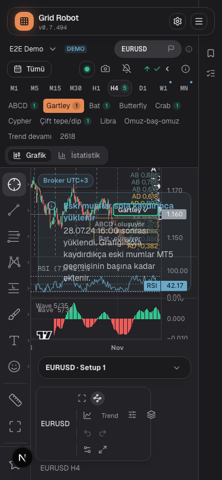
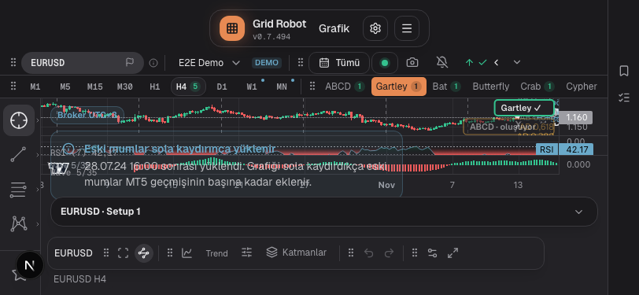
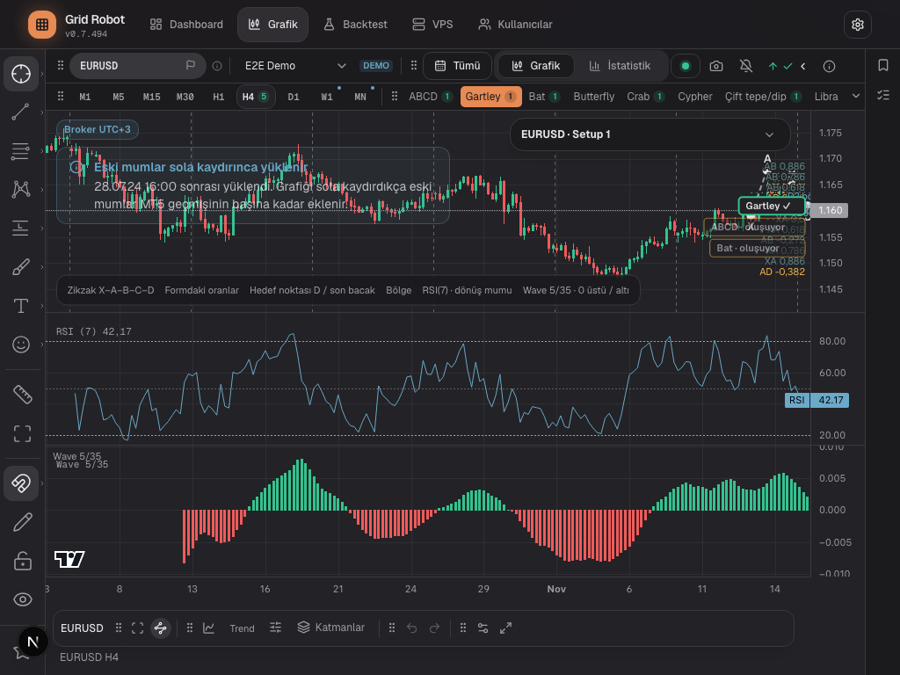
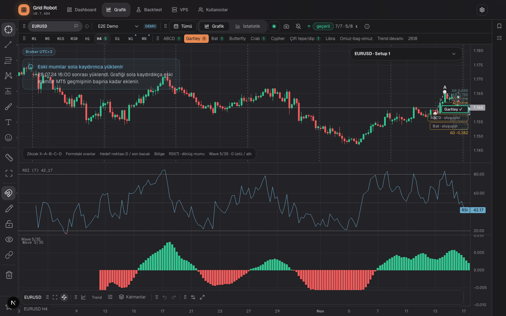

# Chart U4-4a: the switch to one chart

## Request
Step U4-4a of plan 1107-A21 (`2026-11-08-one-chart-no-modes-plan.md`). `/chart` shows one chart. The mode switch goes. All nine timeframes are always visible. The formation layer and the setup layers of the symbol sit on the same chart. The side bar and the setup card stay for one more step (U4-4b merges them). No tool is deleted.

## Solution
| File | Change |
|---|---|
| `components/chart-page/OneChart.tsx` (`git mv` from `chart-workspace/FreeChartPanel.tsx`) | The one chart. Symbol select, nine timeframes with hit counts, formation row, `FormationActions`, formation layer on D1/H4/H1/M15, setup layers through `useSetupLayers`, side bar (Conditions, Favorites), setup card. |
| `app/chart/page.tsx`, `hooks/useChartParams.ts` (new) | `ChartRoot` opens `OneChart` or Statistics. The hook uses `parseChartUrl` and `buildChartUrl`. |
| `components/chart-page/ChartTopBar.tsx` | The slot `mode` is optional (the old shells still pass it until U4-5). New slot `forms` (package `formations`). |
| `components/chart-page/LayersMenu.tsx`, `ChartView.tsx` | Groups "Formation" (help text) and "Setup" (switches). |
| `components/analysis/chart/TimeframeSelect.tsx` | Optional hit count per timeframe. The dot on W1 and MN is the existing calendar dot. |
| `components/chart/SetupCardTabs.tsx`, `hooks/useSetupLayers.ts` | Setup select in "Overview" (more than one setup of the symbol), card for a symbol without setup, W1 and MN markers on the period start (1107-A21.10). The fractal switch is always listed and off for a setup without fractal entry. |
| `components/formation/FormationActions.tsx` | `enabled=false` also hides the step buttons; one hint for the past moment and one for the image. |
| `lib/chart-workspace/legacyKeys.ts` (new) | One storage key `chart` per product; first open merges the drawings of the three old keys (1107-A21.6). |
| `hooks/useTrendConfirm.ts` | Always on (1107-A21.8). |
| `next.config.ts`, `lib/formation/alarmNotify.ts` | Redirect and `formationUrl` carry no `mode`. |
| `e2e/mocked/chart-one-chart.spec.ts` (new) | UI-22 tests. Written first, red, then green. |

## Assumptions (the plan is silent)
- The data of the chart is the request of the free chart (all timeframes). In a past view (`at`) the request ends at the moment and only closed candles stay; no live price. The formation layer draws on these candles.
- Without a hit for the URL formation on the timeframe, the first formation with a hit is shown. The row shows only formations with a candidate (valid, forming or invalid) on the timeframe, so the conditions can explain an invalid one.
- The trend line draws the draft (preview). Formations and alarm use the applied setting.
- The favorites views (timeframes, formations) show in the Favorites tab of the side bar only. The top bar always shows the nine timeframes and the formations of the symbol.
- The setup of the layers is the URL `zone` if it belongs to the symbol, else the first setup of the symbol.
- Old storage keys stay. Indicators, layers and alarms come from the first old document that has any (order Free, Setup, Formation).

## Other changes the switch needed
- `FormationLayer` reads the look of the chart document (`workspaceKey`): the setting "line menu" is per product in the one chart.
- `FloatingCard` has `defaultOpen`. The setup card starts closed while a formation is drawn: the open card (from lg) covers the right edge, where the formation lies.
- The data quality banner of the chart lets clicks through to the chart (text only, no control).
- `TimeframeSelect` has `flat`: the nine buttons stand without frame in row 2 (the top bar stays 70 px high). The tabs "Chart / Statistik" use 12 px text like the rest of the bar.
- `FormationSymbolSelect` has `className`: in the phone layout the slot of the top bar limits the width already, a second 42 % hid the symbol name.
- The formation actions (past moment, image, alarm, status chip) carry `data-keep`: with the range and the tabs in the same package, the row is crowded, and the actions must not go into the arrow menu first.
- The scan and the alarm run on the symbol of the page. The chart itself needs a symbol of the broker list. Candles that do not rise in time are never drawn (the chart library throws): the scan alert shows instead.
- `DockProvider`: after more than four quick switches the fallback state of a free package stays. Reason: with the side bar strip the free area is narrower, and the test "free group does not fit" (chart-toolbar-groups) ended in an endless render loop ("Maximum update depth") at 280 px. The cause lies in the dock algorithm (the bottom row changes the free area) and is older than this step.
- The formation drawing lies over the whole chart now (not only over the candles of the scan). Its hit areas pass the wheel to the chart (`forwardWheel`), the notices container lets clicks through (`ChartOverlays`), and the data quality banner is text only. Without these, a wheel zoom or a click on a drawing tool under a formation line did nothing.
- A candle series that is not in order (a mock or a broker error) is sorted and loses double times before it reaches the chart library, which throws on it (`ascending` in `OneChart`). The search reports such data on its own (alert "Arama başarısız").
- On the formation timeframes the series of the chart never holds the candle of the request: it comes from the search (the common M15 price, FRM-31) or from the stream. So the series does not change when the search ends. `rememberChartView` (`runtime.ts`) counts that candle: the rule "view reaches the end" has one bar more of tolerance (`count - 3`).
- The scan and the alarm start only for a symbol of the loaded broker list (an empty list: they start anyway), so an invalid symbol after an account change makes no requests (ANA-16).
- The phone top bar (`ChartTopBar`, not docked): the DOM follows the visual order (range, tools, timeframes, formations, view), the formation row is one line that scrolls sideways (30 px), the symbol slot has no second width limit.
- `useChartParams` is new and has no Statistics-only parts: Statistics uses the same hook. The two users of it (page and chart) each hold their own "pending" address; two writes of the same render from both could overwrite each other (rare, not seen).
- Known limits: the old keys of linked drawings (`links`) are not copied to the new key; with the range "All" the trend line starts without a warm-up (a chosen range still uses the warm-up request); the live bot lines (levels, positions, orders) are not drawn in a past view.
- The retry of the account list (every 10 s after a failed first load) moved from `FormationView` to `ChartRoot`.
- The chart without a known account (`NoAccountChart`) keeps the top bar with the alarm menu, as the formation page did.

## Test changes
The owner approved the places and names of the plan table. Where a test changed in content, the reason is here.
| Test | Change | Reason |
|---|---|---|
| `chart-one-page.spec.ts` (UI-14) | The mode tests become "old link opens the chart, no mode switch", "account stays when symbol and timeframe change"; `formationUrl` has no `mode`. | The switch is gone (UI-22 covers the same rules). |
| `formation-page.spec.ts` "Klick auf eine Formation springt zur Zeiteinheit ihres Treffers" | Now: the row shows only formations with a candidate on the timeframe; with H4 the Gartley button appears. | Plan: the row shows only formations of the selected timeframe. |
| `formation-page.spec.ts` "Ohne Treffer steht der Leerzustand" | `formation-forms-empty` (note) instead of `formation-empty`. | The chart has no formation-empty text any more. |
| `formation-page.spec.ts` FRM-45 "Im Modus Frei gibt es den Schalter nicht" | Uses M5. | On formation timeframes the switch exists. |
| `formation-page.spec.ts` FRM-42 Setup (2 tests) | Replaced by one test: draft and confirm apply on every timeframe. | Decision 1107-A21.8. |
| `formation-page.spec.ts` FRM-29 "Klick auf einen Zeitraum filtert ohne neue Anfragen" | Checks that no new search runs (`data-scan-runs`, favorites scan), not the number of rates requests. | The chart loads its own candles for a new timeframe. |
| `formation-page.spec.ts` FRM-29 "Die Zeilen stehen sichtbar nie doppelt" | Favorites rows are in the sidebar tab only. | The top bar always shows the nine timeframes and the formation row. |
| `formation-page.spec.ts` FRM-30 "Zwei Tabs lösen nur eine Suche aus" | Counts the requests of the favorite (EURUSD) while the page shows XAUUSD. | Every tab now also loads the chart and the search of its own symbol. |
| `formation-page.spec.ts` "Scheitert das erste Laden der Konten" | At least 2 calls, and no more calls after the list is there. | Page, navigation and search runner each start the first load. |
| `formation-page.spec.ts` FRM-22/23 | The reserve under the chart includes the closed setup card (`--floating-card`); the ids of the top bar; the end of the test opens Statistics. | Layout of the one chart. |
| `formation-page.spec.ts` FRM-27 "Eine Formation, die nach dem Einschalten gültig wird …" | Test time limit 60 s (was 30 s). No assertion changed. | The page also loads the chart candles for each 15-minute jump; the test needs about 42 s. |
| `chart-dock-s4.spec.ts` (f) "Setup/Frei 720 px" | The range may stand in the arrow menu; the menu list must contain the tabs and the license in order (it was the exact list). | CI failed here (the local run passed): the package holds the formation actions too, which are kept in the row, so on a runner with other font widths the range goes into the menu. The width is the cause, not a defect of the dock. An attempt to keep the range in the row and release the past moment and the image broke the image tests, so it was dropped. |
| `formation-line-menu.spec.ts` (`pointOn`) | The click point is a point of the hit line where it is on top (`elementFromPoint`), not always the middle. | The chart shows all candles, so the lines of the formation lie close; the middle of a leg can lie under another role. |
| `chart-workspace.spec.ts` | `range=7d` becomes `range=last7`; the radio "H4" becomes `timeframe-H4`; the drawing click lies below the two bar rows; the URL has no `tf=H4` (default); the settings request is expected (setups of the symbol). The side bar starts closed (like `chart-older-heavy.spec.ts`). | `7d` was no preset and fell back to the default range, which is "All" now. The count badge changes the name of the radio. The side bar (288 px) makes the chart narrower. |
| `chart-layers.spec.ts` (UI-11 narrow width), `chart-page.spec.ts` (UI-10 at 1024 px) | The side bar starts closed. In UI-10 the tabs "Chart / Statistik" may stand in the bar or in the arrow menu. | From 1024 px the side bar is open on the first visit and takes 288 px. |
| `analysis.spec.ts`, `accounts.spec.ts`, `logs-ui.spec.ts`, `tooltips.spec.ts` | The clicks on the mode switch go; the setup card names the setup. "Old setup link" test: the account change drops zone and symbol. | The switch is gone. |
| Dock specs (`chart-dock-s4/s5`, `chart-dock`, `chart-dock-formation`, `chart-toolbar*`, `chart-pane-model`, `chart-indicator-dialog`, `chart-single-rsi`) | The package `mode` as example becomes `symbol`; narrower test widths where the strip makes the row too narrow; the one chart starts without the user EWO pane. | See the report of the dock agent in the PR text. |

## Verification
- `scripts/features/run.sh e2e UI-22`: 27 tests (15 page tests, 12 lib tests).
- Screenshots at four widths, formation H4 with the setup card closed (`docs/journal/images/2026-11-08-chart-u4-4a-*.png`). Horizontal overflow (`scrollWidth - clientWidth`) was 0 at 375 × 812, 812 × 375, 1024 × 768 and 1440 × 900.
  - 
  - 
  - 
  - 
- RSI divergence marks: the layer now reads the closed candles of the chart (all fixture candles), the old layer read the scan view. In the fixture both series are the same candles; the marks of the screenshot lie where the layer put them before (`FormationLayer` is unchanged). No pixel comparison before and after was made.

## Open points
- [ ] U4-4b merges the side bar and the setup card. The favorites strip of the top bar is gone in this step (rows are in the sidebar tab); the data quality banner (range "All") covers much of the chart at 375 px and needs a decision in the design.
- [ ] The user EWO pane is no default of the one chart (the system Wave pane shows EWO). Decide in U4-4b if the default stays.
