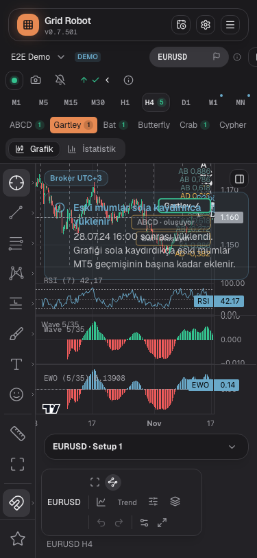
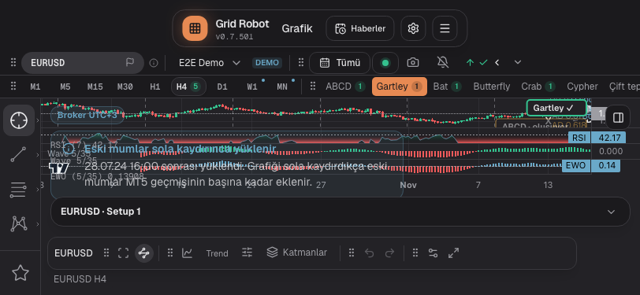
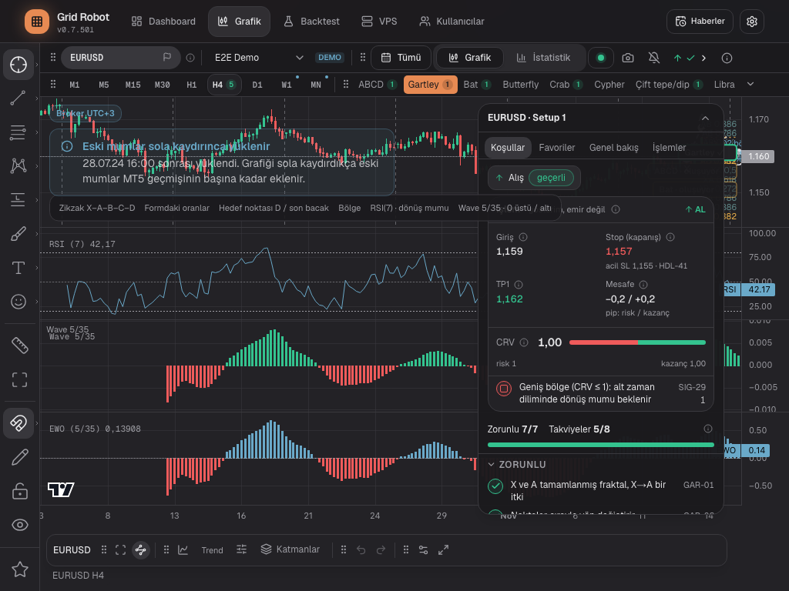
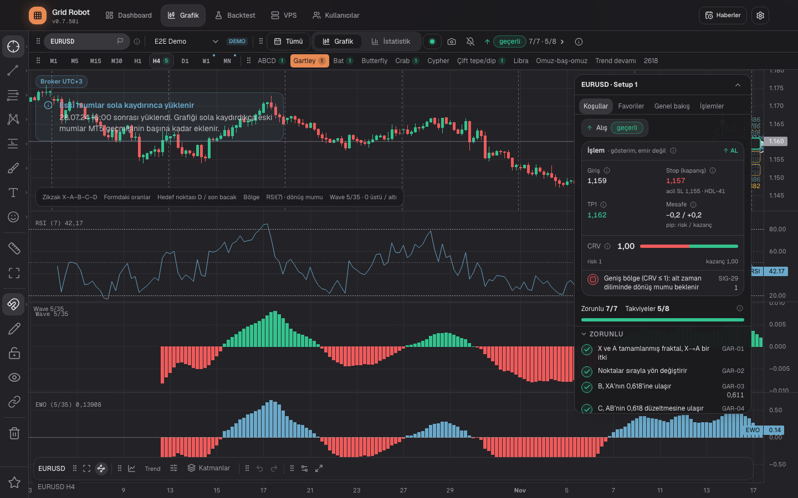

# Chart U4-4b: one card

## Request
Step U4-4b of plan 1107-A21 (`2026-11-08-one-chart-no-modes-plan.md`, decision 1107-A21.4). The formation side bar and the setup card become one floating card with four tabs: Conditions, Favorites, Overview, Trades. No tool is lost.

## Solution
| File | Change |
|---|---|
| `components/chart-page/ChartCard.tsx` (new) | `FloatingCard` with four tabs. Conditions: `FormationConditions`, or a note on a timeframe without formations (`conditions-off-tf`). Favorites: `FavoritesSidebar` and the add button. Overview and Trades: the setup parts, or the note "no setup" (1107-A21.11). |
| `components/chart-page/OneChart.tsx` | No side bar (`ChartPanel`), no favorites strip, no strip buttons. The status chip toggles the tab Conditions. On the phone a button "Card" (`chart-card-open`) opens the card. |
| `components/chart-page/FloatingCard.tsx` | Optional control from outside (`open`, `tab`, callbacks). Test ids `chart-card-tab-<id>`. |
| `components/chart/SetupCardTabs.tsx` | The tab contents are now `SetupOverview`, `SetupTrades`, `NoSetupNote`. `SetupCardTabs` (old Setup shell) uses them and stays until U4-5. |
| `hooks/useFormationSidebar.ts` | Four tabs. The same storage key `grid-robot-formation-sidebar`, so the user setting stays. New `setOpen`, `selectTab`. |
| i18n, `hints.ts` | `chart.card.conditions`, `chart.card.favorites`, `chart.card.open`, each with `.hint` (tr, en, de). |
| `docs/features/features.yaml` | `ChartCard.tsx` in `code:` of FRM-22, FRM-29, FRM-37, UI-22. |

## Decisions in this step
- The card is open from 1024 px on the first visit and closed below (UI-10 rule), also while a formation is drawn. U4-4a closed it while a formation was drawn; the plan says otherwise, so the old exception (`collapseSignal` in `OneChart`) is gone.
- The button "Card" is not in the top bar package. Inside the dock it made the actions package overflow at 1280 px (`dock-more` visible next to the tabs). It floats at the top right and only shows below lg.
- The card has no width of its own for the Conditions tab: it uses the 320 px of the card. The checklist scrolls inside.
- The old side bar pushed the chart aside (`panelShown`). The card floats over the chart: the chart area is now as wide as the window (minus the 52 px drawing rail). No empty strip on the right.

## Test changes
Assertions stay. Places and names change (sidebar and strip test ids to `chart-card-tab-*`, `chart-floating-card`).
| Test | Change | Reason |
|---|---|---|
| 8 spec files with `openCard` (`accounts`, `analysis`, `analysis-chart`, `analysis-trades`, `bot-metrics`, `logs-ui`, `system`, `tooltips`), `chart-layers-menu`, `chart-page` | After the expand, the helper selects the tab "Overview". | The card now keeps the last tab (default Conditions). |
| `formation-page.spec.ts` FRM-29 (14 places), FRM-37 | `favorites-toggle` becomes the helper `showCardTab(page, 'favorites')`; `sidebar-tab-*` becomes `chart-card-tab-*`. | One card. |
| `formation-page.spec.ts` FRM-37 "Die offene Seitenleiste schiebt den Chart" (2 widths) and "(20 px)" | Now: the card floats over the chart, the chart keeps the full width, the card stays in the window. | The card does not push the chart. |
| `formation-page.spec.ts` FRM-37 "Zwei Reiter", "Offen/zu und Reiter bleiben", "Bei 375 px", "Pfeiltasten" | The strip symbols are gone: the header button of the card closes it, the status chip opens Conditions. `aria-labelledby` is compared with the real tab id. | One card. |
| `formation-page.spec.ts` FRM-23 (2 tests), FRM-37 "Status-Knopf" | Widths: bar 1388 (was 1348), test viewport 1100 for the reserve test, status chip widths 1260 and 1264 px (were 1300 and 1304). | The 40 px strip is gone, so the chart area is 40 px wider at every window width. |
| `chart-one-page.spec.ts` UI-14 "rechts bleibt kein leerer Streifen" | The right edge of the chart area equals the window width; strip and side bar do not exist. | One card. |
| `chart-one-chart.spec.ts` "Auf H4 stehen die Formationszeichnung…" | The card is open; the tab "Overview" is selected, then the setup is checked. | The card is open from lg. |
| `analysis.spec.ts` `inTopbar` | `direct.or(more).first()`. | With the wider bar both the item and `dock-more` can be visible; the helper took them as an error. |
| `analysis.spec.ts` ANA-02 (3 tests) | "no card of the old account" is `not.toContainText('USOUSD')`, no longer `toHaveCount(0)`. | The one card also holds Conditions and Favorites, so it exists without a setup. |
| `formation-line-menu.spec.ts` (all), `formation-trade.spec.ts` | The card starts closed (line menu); the narrow case opens it with `chart-card-open`. | See "Open points": the open card covers the formation. |

New tests (`chart-one-chart.spec.ts`, `@UI-22`): one card with four tabs and no side bar or strip; open from 1024, closed at 1023; each tab shows its content and the tab survives a reload; the status chip opens a closed card on Conditions; note on M5; the button "Card" on the phone (and hidden from lg).

Note on the order: the new tests were written after the code. I did not run them against the old code, so "red first" is not proven for them. They check what they claim: the tab is found and clicked, not counted.

## Verification
- Screenshots (formation H4, card open from lg), overflow (`scrollWidth - clientWidth`) was 0 at all four sizes:
  - 
  - 
  - 
  - 
- Measure at 375 px: the formation row is one line (all buttons have the same top, 170 px). A21.14 (three lines) did not show in this fixture. Not changed.

## Open points
- [ ] **The open card covers the formation (known conflict).** At 1024 × 768 the card lies at x 620–940, y 134–669; at 1440 × 900 at x 1036–1356, y 134–748. All 8 drawn formation elements (zigzag, ratios, target, zone) of the H4 fixture lie inside the card box (see the 1440 screenshot: points D and the target are hidden). Below 1024 px the card is closed, so nothing is covered. The rule "open from 1024" was applied as the plan says; I did not change it. Needs a decision (for example: closed while a formation is drawn, as in U4-4a, or a card that docks to the chart). The line-menu tests start the card closed for this reason.
- [ ] A21.12, A21.13, A21.14, A21.17: not touched (waiting for the owner).
- [ ] U4-4b is marked in the plan journal. U4-5 removes `ChartPanel.tsx`, `FormationSidebarTabs.tsx` and `FormationView` (they still use the side bar).
