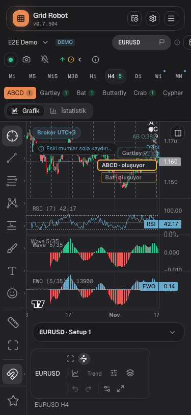
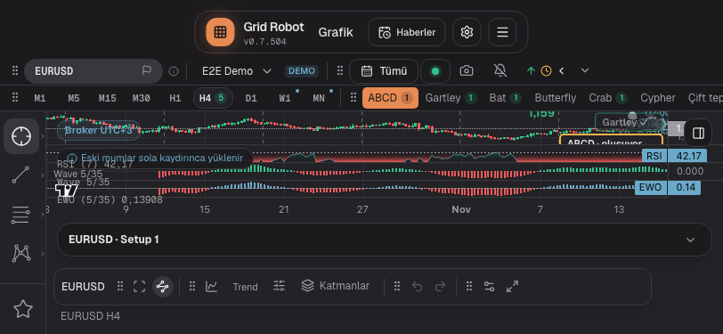
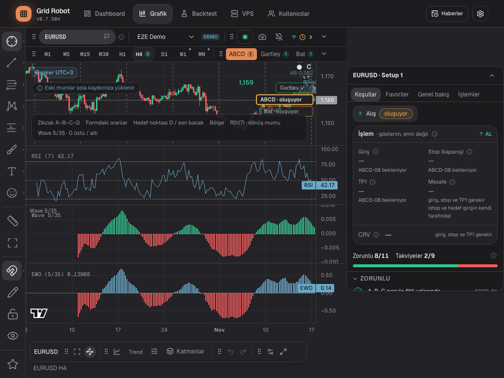
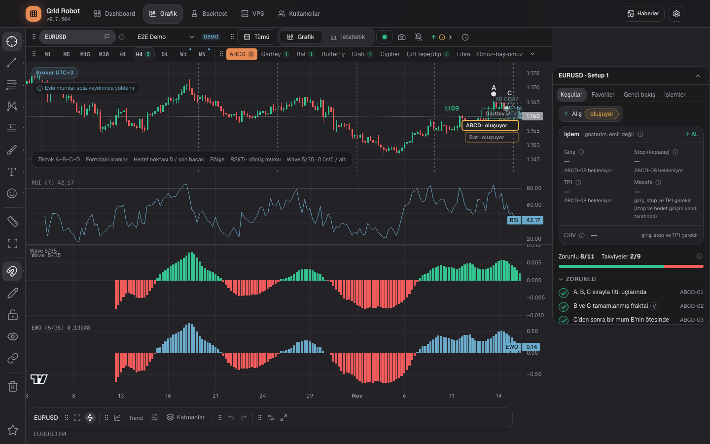

# Chart U4-5b: four fixes

## Request
Step U4-5b of plan 1107-A21 (`2026-11-08-one-chart-no-modes-plan.md`): decisions A21.12, A21.15, A21.16, A21.18.

## Solution
| Decision | Change |
|---|---|
| A21.18 card next to the chart | From 1024 px the open card stands next to the chart (`FloatingCard`: `lg:left-full`, 320 px). `OneChart` passes `panelShown={sidebar.open}` and `ChartPage` narrows `formation-main` by 320 px (`lg:right-80`). The closed card is still a small header over the chart. Below 1024 px the card floats as before. The wide variant of the Trades tab is gone: the card has one width, the tab content scrolls in both directions. |
| A21.12 data quality chip | `DataQualityBanner` has a new prop `chip`. The note "older candles load on scroll" is a one-line button at the top left (`data-quality-chip`, hint `analysis.data.chip.hint` in tr/en/de, `aria-expanded`). A click opens the full text (`data-quality-chip-text`); Escape or a click outside closes it. The chip is at most 168 px wide at 375 px (10.5 rem). Warnings (missing ranges, candle limit, full database) stay full alerts. |
| A21.15 FRM-27 time | Measured, not changed. See below. |
| A21.16 `links` | `legacyLinkFor()` in `lib/chart-workspace/legacyKeys.ts`: on the first open the new key `chart` joins the linked drawing set (`@linked:…`) of the first old key that has one (order Free, Setup, Formation). An existing link of the new key stays. `setLinked` runs in a `try/catch`: a damaged drawing document in the old set must not break the page (it threw "Invalid drawing document" in a first test run). A linked old key keeps its live drawings in the shared set, so `legacyDocumentsForMerge()` drops its own (stale) drawings before the merge; else deleted drawings would come back (reviewer finding). The link is taken over only on the first open, when the new key has no document yet: a product opened since v0.7.504 keeps its state, and a deliberate unlink is not undone. |

## A21.15: measurement of FRM-27
Test: "Eine Formation, die nach dem Einschalten gültig wird …", free machine, one worker, instrumented with the number of `rates` requests (temporary, removed).

| Point | Time in test body | `rates` requests (D1 / H4 / H1 / M15) |
|---|---|---|
| after open | 0.7 s | 5 (1 / 2 / 1 / 1) |
| alarm on | 1.8 s | 9 (2 / 3 / 2 / 2) |
| after the first 15-minute jump | 13.0 s | 58 (3 / 34 / 3 / 18) |
| after the second jump | 19.0 s | 107 (4 / 65 / 4 / 34) |
| end | 19.7 s | 116 (6 / 68 / 6 / 36) |

One jump (`page.clock.runFor(15 min)`) causes about 49 requests: 31 H4, 16 M15, 1 D1, 1 H1. All have `from` and `to`. The cause is not a reload for each 15-minute step. The fake clock fires the 60-second tail refresh (`REFRESH_MS` in `useMarketRates`) of every hook 15 times in one jump. Three hooks read H4 (chart, formation scan, trend line), one reads M15 (scan): 3 × ~10 and ~15 requests. `refreshTail` loads only the tail. In real time this is one request per minute per hook, as designed. The requests are therefore needed by the timers, not by the chart reload, and a candle cache would not remove them.

Decision: the limit stays at 60 s (the test body needs 20 s on a free machine and about 40 s under load; 30 s is not safe). The comment in the test now says why.
Follow-up (not in this step): the three H4 hooks request the same range. One shared request would cut about 20 requests per jump and the same load in the real app.

## Test changes
| Test | Change | Reason |
|---|---|---|
| `formation-line-menu.spec.ts` `openPage` | The `localStorage` workaround (card starts closed) is removed. | The card no longer covers the formation. 20 of 20 tests pass with the open card. |
| `formation-page.spec.ts` FRM-37 "Die offene Karte steht neben dem Chart …" (was "schwebt über dem Chart …") | Widths 1440, 1100 and 1024 px. `main.width = width − 320`, `card.left ≥ main.right`, chart right edge ≤ `card.left`, after closing `main.width = width` and the chart is 320 px wider. | The old strictness (U4-4b before PR 460) is back, with the new numbers. |
| FRM-37 "Mit größerer Schrift im Browser (20 px) …" | `main.right ≤ card.left`, and the chart right edge ≤ `card.left` (poll). The title says "überlappt der Chart die offene Karte nicht" again. | As above. |
| FRM-23 1100 px geometry | Chart width 728 (was 1048); `card.x ≥ chart.x + chart.width`. | The card stands next to the chart. |
| FRM-23 same test, step "Desktoplinks" | The checks of `nav-menu` and the app link stay at 1100 px; both themes go to 1440 px only before the click on the tab "Statistik" (the light theme did already). The new test above covers the arrow menu with the open card. | At 1100 px the chart is 728 px wide and the tabs stand in the arrow menu (UI-17 A4.10). This step checks the desktop bar, not the card. The geometry assertions above stay at 1100 px. |
| FRM-27 | Only the comment on the 60 s limit. | See the measurement. |
| `chart-one-chart.spec.ts` (new) | Chip test at 375 and 1440 px; link test (Setup before Formation, other symbol untouched, second open unchanged); "Statistik" reachable with the open card at 1024 and 1100 px (direct or in the arrow menu). | A21.12, A21.16, FRM-23 step. |
| `chart-legacy-keys-lib.spec.ts` (new) | 5 lib tests for `legacyLinkFor` and `legacyDocumentsForMerge`. | A21.16. |

Finding while testing: with a chip box that was wider than its button, `pointer-events-auto` on the box covered the formation line at 375 px and FRM-47 "375 px: Menü und Tabelle laufen nicht über" failed. The box now lets clicks through; only the button and the open text catch them. No assertion changed for this.

## Verification
- `scripts/features/precheck.sh`: see the PR.
- Screenshots (formation H4, card open from lg, chip closed):
  - 
  - 
  - 
  - 

## Open points
- [ ] U4-6: live check on the DEMO account and on a phone, UI-22 signature.
- [ ] Follow-up: share one H4 request between chart, scan and trend hooks (see A21.15).
- [ ] `FloatingCard` has dead code (`defaultOpen`, `collapseSignal`, own `userOpen`): `ChartCard` always controls it. Remove in a later cleanup.
- [ ] The Trades tab has a 320 px card now. Check the table on a real screen in U4-6.
