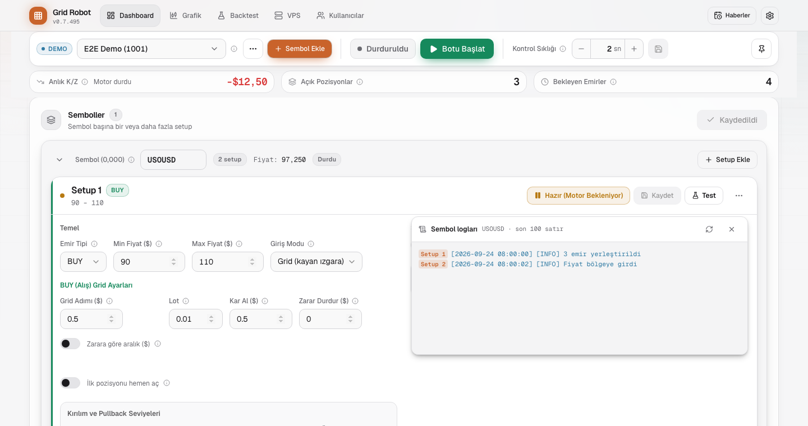
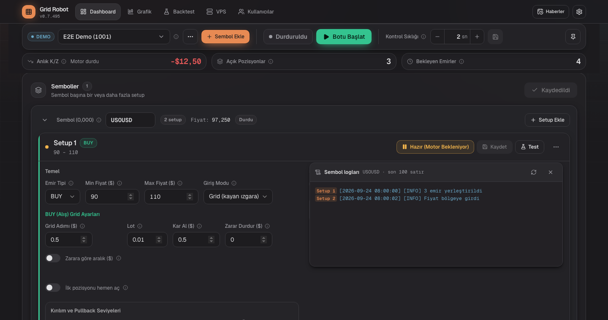
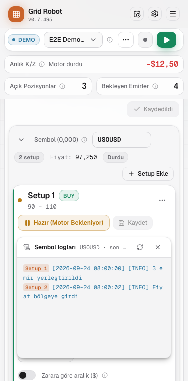
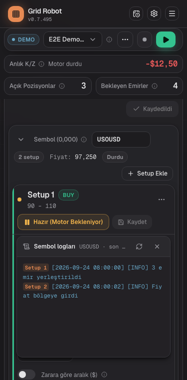

# Compact symbol card, step K1: header, logs panel, shadows

## Request
Step K1 of plan 1108-A5 (compact symbol card, design V4, approved 2026-11-08). Make the header of the symbol card one row, move "Sembol logları" into the setup menu, give the cards a shadow. K2 (fields), K3 (summary state) and K4 (check) are not part of this step.

## Solution
| File | Change |
|---|---|
| `src/app/globals.css` | New tokens `--shadow-card`, `--shadow-symbol`, `--shadow-float`, each in `:root` and `.dark`. The symbol shadow is smaller below 640 px. |
| `src/components/zone/SymbolCard.tsx` | One header row: arrow, label and 118 px input, setup count, price, badges, "Setup Ekle" at the right. The log strip is gone. The card keeps the panel state and gives it to its setups through a context. Shadow `--shadow-symbol`. |
| `src/components/zone/SymbolLogs.tsx` | Context plus `SymbolLogsPanel`. The panel sits under the header of the setup that opened it, right-aligned, 600 px at most, 200 px body. Escape, a click outside and the close button close it. It polls every 10 s only while open. |
| `src/components/zone/ZoneHeader.tsx` | The menu has "Sembol logları", a separator and "Sil". Below 640 px "Test" is the first menu item and the header has two rows. Escape closes the menu. |
| `src/components/zone/ZoneCard.tsx` | Shadow `--shadow-card`; renders the panel. |
| `src/i18n/messages/zone.ts`, `hints.ts` | `zone.logs.close`, `zone.logs.subtitle` and hints (tr/en/de). |
| `e2e/mocked/logs-ui.spec.ts`, `mobile-layout.spec.ts`, `fixtures/dashboard.ts` | LOG-07 tests open the panel from the menu (assertions not weakened). New: Escape, outside click and close button; at 375 px "Test" is in the menu and the panel stays in the card without page overflow (3 languages). |
| `docs/features/features.yaml` | LOG-07, ZON-20, UI-08 texts and `code:` list. |

## Why
- The panel state lives in the symbol card, not in a setup: all setup menus of one symbol open the same panel, as the plan says.
- The panel is rendered by the setup card (`absolute`, under its header) and not by the symbol card, so it stays next to the menu that opened it.
- A click on the empty part of the symbol header still folds the card. The outside-click test therefore clicks the page margin.

## Screenshots
Symbol card with open panel, 1440 px and 375 px, light and dark (test data: two setups).

## Open points
- [ ] K2 (three field boxes), K3 (summary state), K4 (check) of plan 1108-A5.
