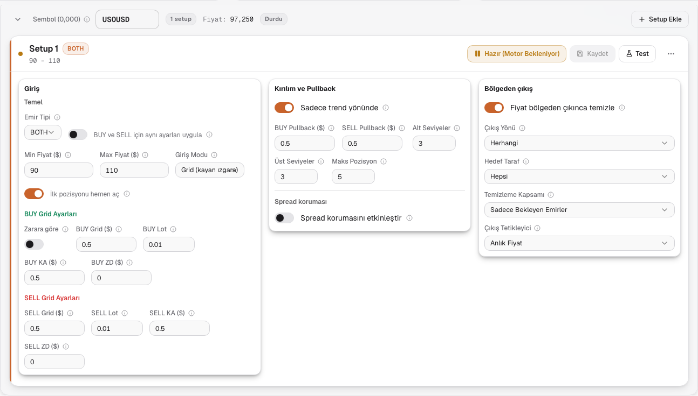
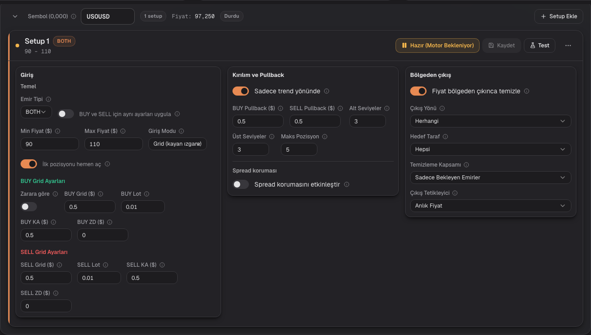
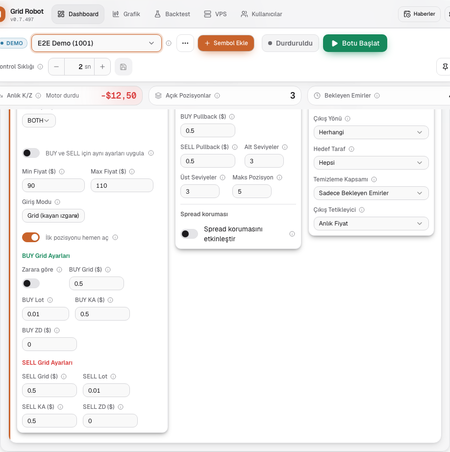
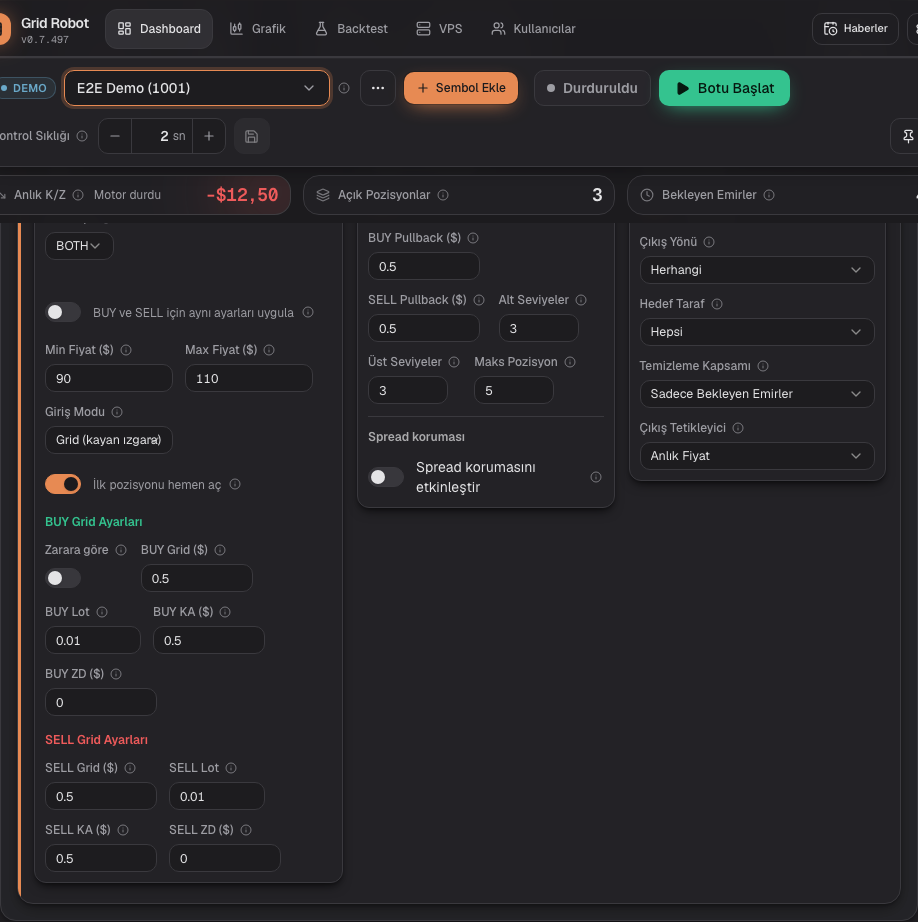
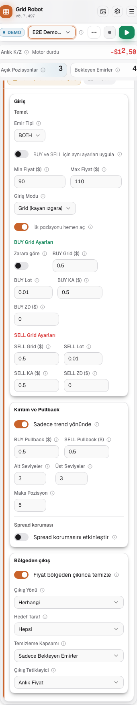
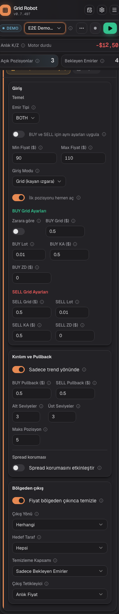

# Compact symbol card, step K2: three field boxes

## Request
Step K2 of plan 1108-A5 (design V4). Split the setup fields on the dashboard into three boxes and make the inputs smaller. K3 (summary state) is not part of this step; "Kaydet" stays as it is.

## Solution
| File | Change |
|---|---|
| `components/zone/ZoneFieldsEditor.tsx` | New prop `layout`. `columns` (dashboard, `ZoneCard`): from `lg` three boxes 1.2fr 1fr 1fr, 14 px gap, padding 12/14/20/16 px; below `lg` the boxes stack. Test ids `zone-entry-column`, `zone-guard-column`, `zone-exit-column`. The default layout is the old two columns (backtest modal `SetupEditor`). "İlk pozisyonu hemen aç" now sits below the row Temel in both layouts (grid mode only). |
| `ZoneGridFields.tsx` | "Zarara göre" is a field column before "Grid Adımı" (label above, switch at input height). The instant-entry switch moved out. |
| `ZoneBreakoutFields.tsx`, `ZoneSpreadFields.tsx`, `ZoneExitFields.tsx` | Prop `plain`: no own frame inside a box. Trend switch and exit switch in their own row; "Spread koruması" below a divider; the four exit selects in pairs. |
| `components/ui/switch.tsx` | `SwitchToggle` (the button alone) and `ariaLabel`, so the short label can keep the full name for screen readers. |
| `app/globals.css` | `.setup-fields` (only the `columns` layout): `.input-s` 28 px high and 12.5 px font from 640 px, 32 px below; no spin buttons (arrow keys still work). `.input-s` itself stays 36 px, because other forms (account, connection, backtest) share it and sit next to `h-9` buttons. The plan text says `.input-s`; this is a narrower reading. |
| `i18n/messages/zone.ts` | `zone.stepByLoss.short`, `zone.box.entry`, `zone.box.guard`, `zone.box.exit` (tr/en/de). The hint stays `zone.stepByLoss.hint`. |
| `SymbolCard.tsx` | Indent of the "Setup Ekle" button fixed (left over from K1). |
| `e2e/mocked/setup-columns.spec.ts` (new) | Box order, ratio and gap at 1440 and 1024 px; switch places; 28 px height and no spin buttons; backtest modal keeps two columns; 375 px stacked boxes without overflow for BUY, BOTH split and fractal BOTH split. |
| `setup-layout.spec.ts`, `zones.spec.ts`, `mobile-layout.spec.ts` | Only places change: "Zarara göre" before the grid step (same row, input height); "Nur Trend" and "Bereinigen" in their own row above their fields. `zoneSwitch` uses the short label. The fractal test also checks that the trend switch is missing, because the old title check can no longer fail. |
| `docs/features/features.yaml` | ZON-20, ZON-13, UI-08 texts and `code:` lists. |

## Why
- The boxes use the full width; each box holds one subject (design V4).
- `.setup-fields` is a CSS class on the editor root of the `columns` layout; the backtest modal keeps its field size and number spin buttons, but gets the new switch order (plan 1108-A7.1).
- The exit and spread grids switch to two columns by box width (`@container`), not by viewport; the exit box is only about 280 px wide at 1440 px, so its selects stay in one column there. The many `NumberInput` calls stay unchanged.
- The backtest modal is 896 px wide; three boxes do not fit, so it keeps the default layout (plan 1108-A7.1).
- Red first: the new spec was written before the code, but the red run was skipped because each run needs a full Next build. The first green run came after the code.

## Screenshots
Symbol card with one BOTH setup (split, trend, exit and instant entry on).

## Open points
- [ ] Screenshots were taken before the review fixes (container grid, scoped input size); the exit box now shows one column at 1440 px. Check the look in K4.
- [ ] K3 (summary state), K4 (check) of plan 1108-A5.
