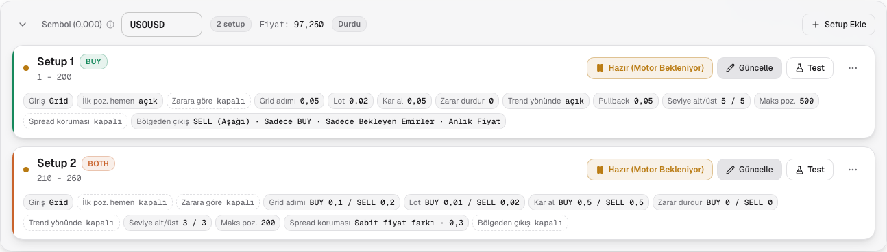
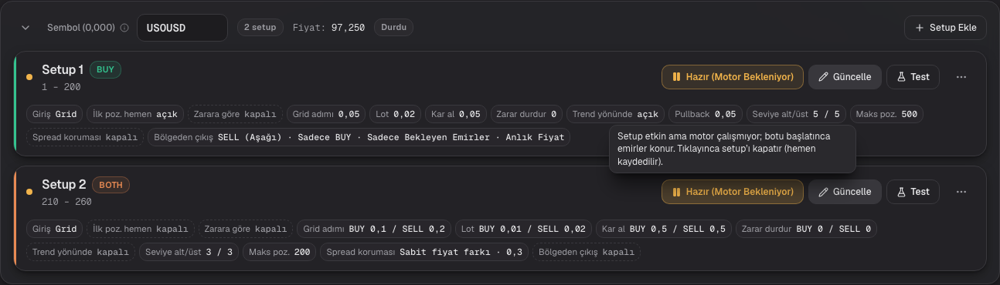
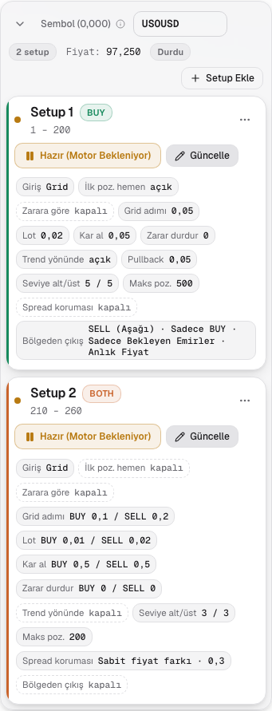
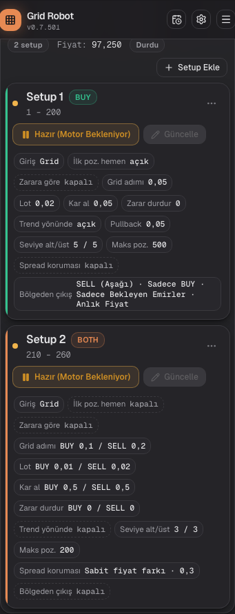
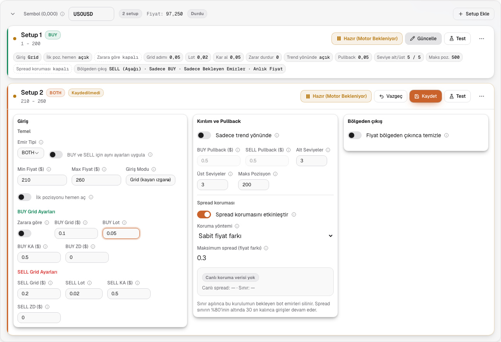
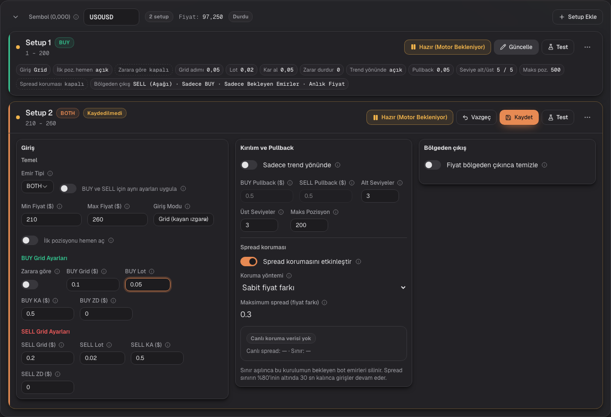
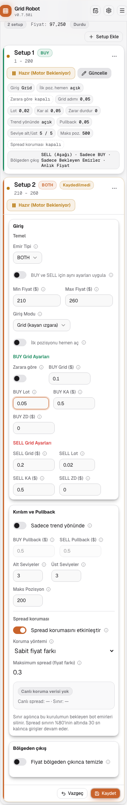
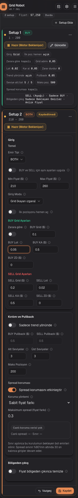

# Compact symbol card, step K3: summary state

## Request
Step K3 of plan 1108-A5 (design V4). Every saved setup on the dashboard shows a summary row. "Güncelle" opens the fields. K4 (check on the DEMO account, signatures) is not part of this step.

## Solution
| File | Change |
|---|---|
| `lib/setupSummary.ts` (new) | Pure function `buildSetupSummary(zone, { t, number })`. It returns the chips (`id`, `box`, `label`, `value`, `off`) in the order of the three boxes. Grid: mode, first position instantly, by loss, grid step, lot, take profit, stop loss, trend, pullback (only with trend), levels, max positions. Fractal: mode, order type, timeframe, lot, order count, max positions, next-order loss, SL, TP. Both modes end with spread guard and exit. `step_by_loss` adds the unit `$`. BOTH without sync shows `BUY a / SELL b` in one chip. |
| `components/zone/SetupSummary.tsx` (new) | The chips as a list. Label grey, value in mono. An off option has a dashed border. Every chip has a tooltip (`zone.summary.<id>.hint`). |
| `components/zone/ZoneEditActions.tsx` (new) | "Vazgeç" and "Kaydet". The header uses it on desktop. `ZoneCard` uses it as a footer below 640 px. |
| `hooks/useSetupEditState.ts` (new) | Holds only the setups opened by hand with "Güncelle". `closeAllSetupForms()` closes them all (window event). |
| `hooks/useMediaQuery.ts` (new) | `useSyncExternalStore` on `matchMedia`; the server render assumes a wide screen. |
| `hooks/useZoneDirtyTracking.ts` | New: `ready` (the saved reference zones are loaded), `original(id)`, `revertedZone(zone)` (saved state; `is_active` stays, it has its own save path). |
| `components/ZoneSettingsPanel.tsx` | A setup is open when it was opened by hand, or when `ready` and it is modified or never saved. Success of a save closes the form. "Vazgeç" reverts the setup, or deletes it when it was never saved. |
| `components/zone/ZoneCard.tsx`, `ZoneHeader.tsx`, `types.ts` | Summary state: header with "Güncelle", no border below the header. Edit state: the three boxes, "Vazgeç" and "Kaydet" in the header, below 640 px in the footer. |
| `app/page.tsx` | The bar "Kaydet" and "İptal" (and the header save button and the discard confirmation) close all forms after the action. |
| `i18n/messages/zone.ts`, `hints.ts` | `zone.header.edit`, `zone.header.cancel`, `zone.summary.*` and every `.hint` (tr, en, de). |
| `docs/features/features.yaml` | New entry ZON-22. |
| `e2e/fixtures/dashboard.ts` | Helper `openSetup(card)`: clicks "Güncelle" when the form is closed and waits for the boxes. It does nothing when the form is already open. |

## Why
- A modified or new setup is open by derivation (`ready && isGlobalDirty !== false && modified(zone)`), not by a stored flag. "Vazgeç" and a successful save change the data, so the form closes by itself and no state can go out of step (rule 1108-A6.3).
- Two guards stop false opens while the page loads. `ready` waits for the saved reference zones. `isGlobalDirty !== false` covers the first commit after the settings arrive: the reference zones are still empty then, so `modified()` is true for every setup. When the whole page is clean, no setup can be modified or new. The reviewer found this second case.
- "Kaydet" and "İptal" of the save bar close all forms through an event, because the bar lives in the page and the forms live in the panel. A changed setup stays open anyway.
- "Vazgeç" on a setup after a symbol rename also returns the symbol of its sibling setups (the rename is for all setups of the symbol). Without this, the symbol card would split in two.
- The chip function takes `t`, the number formatter and the distance unit of the symbol as parameters. This keeps it pure and lets the unit test run without a browser. The next-order loss shows the same number as the form (old price distances are converted).
- Rejected: one summary component per mode. The two modes share the end of the list (spread guard, exit), and one function with one test file is easier to check.
- Chips are focusable and open their hint on a tap (`touchToggle`), because the target device is a phone.

## Tests
- Counted before the change: 63 test definitions in 14 mocked spec files type into, or read, setup fields (`zones`, `backtest-page`, `control-bar`, `fractal-distance-layout`, `legacy-setup-orders`, `logs-ui`, `mobile-layout`, `settings`, `setup-columns`, `setup-layout`, `spread-guard`, `symbol-setups`, `tooltips`; `accounts`, `symbol-cards`, `backtest-presets` and `backtest-grid-parity-lib` need no change). Two more (in `zones.spec.ts`) change through the helper `saveAndReload`, which now opens the first setup after the reload. One live read-only test (`readonly.spec.ts`) also calls `openSetup`. With the language loops this is more runs than definitions.
- `git diff` of the existing specs shows only added `openSetup` calls and import lines. No assertion line was removed or changed. In three tests the call stands before an assertion that would otherwise look at a closed form: `zones.spec.ts` "Einzelne Zone speichern" (a save closes the form), `settings.spec.ts` "Abbrechen verwirft" and `control-bar.spec.ts` "Verwerfen in der Leiste" (the bar closes all forms). In "Start/Pause: Bot aus, ungespeicherte Zone, ungültiges Symbol" the form of setup 1 is opened first: the rename of the symbol opens it anyway, and the layout shift between mouse down and up swallowed the click.
- `openSetup` moves the mouse to the corner after the click. Otherwise the pointer stays over a field and its hint opens in the next hover tests.
- New: `setup-summary-lib.spec.ts` (10 tests for `buildSetupSummary`, written first and red until the module existed) and `setup-summary.spec.ts` (summary after load, new setup open, "Kaydet" off without change, "Vazgeç" reverts, "Vazgeç" deletes a new setup, save closes, a changed setup stays open, bar "Kaydet" and "İptal" close all, fractal and BOTH chips, chip and button hints, 375 px footer without overflow). The red run of the e2e spec was skipped: each run needs a full Next build behind the machine lock.

## Screenshots
Symbol card with two setups (BUY with trend and exit; BOTH without sync with spread guard). Summary state, and edit state of setup 2 with a changed lot ("Kaydet" active, the save bar below). At 375 px the bars and the sticky control area are hidden for the photo, so the footer with "Vazgeç" and "Kaydet" is visible under the form.

Summary:

Edit:

## Verification
- `buildSetupSummary` unit tests: 10 of 10 pass (red first: the import failed until `setupSummary.ts` existed).
- The affected existing specs and the new specs: two runs found the missing `openSetup` calls (30 failures in the first run, 3 in the second). The third run (`spread-guard`, `tooltips`, `setup-summary`) passed, 39 of 39.
- Reviewer, round 2: the test "Dashboard (Bot läuft)" of UI-07 would no longer scan the forms (now opens both setups); the chip of the next-order loss and the revert after a rename got small fixes; the opened forms are forgotten when the account changes.
- Reviewer, round 1: found the missing `openSetup` calls after a reload or save (the specs above), the wrong lot label in the new 375 px test, the load-time open of all forms (second guard `isGlobalDirty !== false`), the unit of the next-order loss, hints without tap or focus, and the partial revert after a symbol rename. All fixed.
- `scripts/features/precheck.sh` did not reach "OK" on this Mac. Catalog, worker tests, lint and tsc passed in both runs, and 3268 of 3271 e2e tests passed in the second run. The failures were `heavy-lock-lib.spec.ts` (R3-03, R3-10; tests of the machine lock itself) and one time-out in `chart-workspace.spec.ts`. The machine load was about 155 (many sessions). `chart-workspace` passes alone; `heavy-lock-lib` passed 24 of 24 in a quiet moment. The change does not touch `scripts/` or `hooks/`. CI on the pull request is the gate.
- Not verified: DEMO account and the real phone (K4).

## Open points
- [ ] K4: check on the DEMO account, sign ZON-22 and the changed entries (ZON-20, UI-07, UI-08).
- [ ] Look of the long exit chip at 375 px (wraps to three lines): check in K4.
- [ ] The exit box at 1440 px is still one column (deviation of K2, K4).
