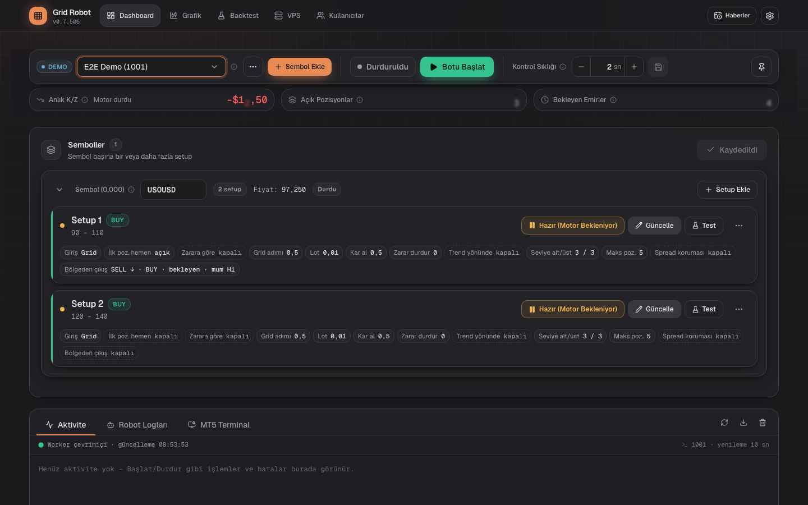
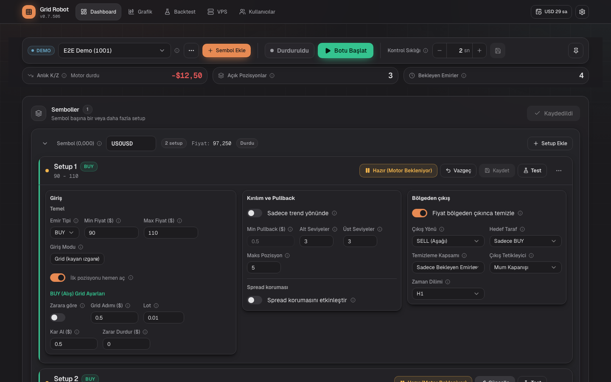
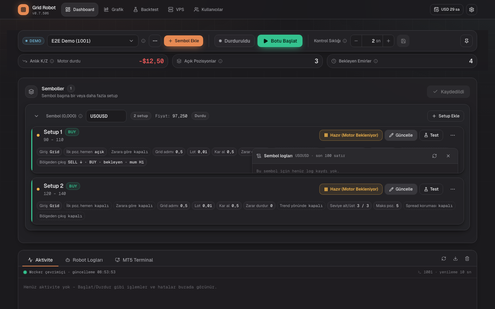
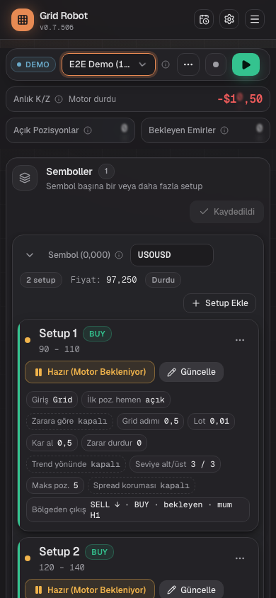
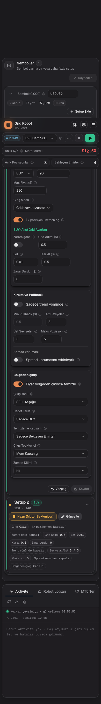
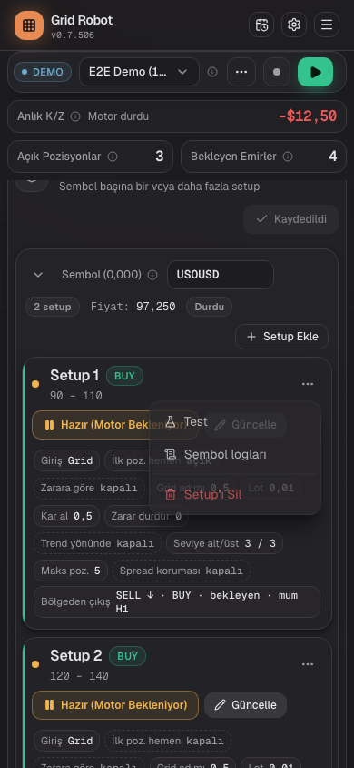
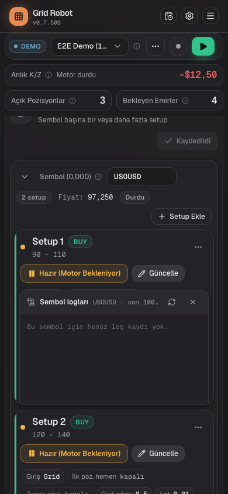

# Compact symbol card, step K4: check and two small fixes

## Request
Step K4 of plan 1108-A5. Check the compact symbol card on the DEMO account (read-only), close two open points from K2 and K3, let the project owner check the phone, then sign the catalog entries.

## Check on the DEMO account
Version v0.7.503, DEMO account, the bot was running. No save, no start or stop, no test order. One switch was set in the form to see the exit box and was reverted with "Vazgeç" (the save button stayed off).

| Check | 1440 px | 390 px |
|---|---|---|
| Every saved setup opens as a summary row | pass | pass |
| "Güncelle" opens the form, "Vazgeç" closes it | pass | pass |
| "Kaydet" is off without a change | pass | pass |
| Boxes in the design order (Giriş, Kırılım ve Pullback, Bölgeden çıkış) | pass | stacked, pass |
| ⋯ menu: "Sembol logları" opens the panel; Escape closes it | pass | pass (panel closes with ✕ or Escape) |
| ⋯ menu has "Test" | stays in the header | pass |
| Footer "Vazgeç" and "Kaydet" under the form | n/a | pass |
| No horizontal scroll (UI-08) | n/a | pass (390 of 390 px) |

The screenshots were taken after fixes (a) and (b), in the mocked e2e build (fake worker, one BUY setup with the exit on and one without). The check itself ran on the live DEMO account before the fixes; the screenshots of that run showed the old exit box (one column).

## Open points from K2 and K3

| Point | Finding | Fix |
|---|---|---|
| (a) Exit selects in one column at 1440 px; the design shows 2×2 | The exit box is 375 px wide, the container query started at 384 px. | `ZoneExitFields.tsx`: `@[22rem]:grid-cols-2`. On the phone the box is 310 px, so it stays one column. |
| (b) A long exit chip wraps to 3 lines at 375 px | The chip showed the full names (about 65 characters) and broke inside words. | The chip shows a short form like the design, "SELL ↓ · BUY · bekleyen · anlık" (new keys `zone.summary.exit.*` in tr, en, de). The full names are in the tooltip and the `aria-label`. The value no longer breaks inside a word. The project owner chose "Kısa çipler" on 2026-11-08. |

## Tests
- `setup-columns.spec.ts` (ZON-20): 2×2 at 1440 px; one column at 390 px. Red before the fix (62 px between the first two selects).
- `setup-summary-lib.spec.ts` (ZON-22): the short value and the `full` value of the exit chip. Red run done: with the old `setupSummary.ts` the exit test failed and 9 others passed; with the new code all 10 pass.
- `setup-summary.spec.ts` (ZON-22, UI-08): at 375 px the exit chip has at most 2 lines, no word break, the full names in the `aria-label`. The red run of this e2e test was skipped (each e2e run needs a full Next build behind the machine lock). It passes with the fix.
- Catalog: ZON-22 text.

## Open points
- [x] Phone check: the project owner confirmed with "devam et" (2026-11-09).
- [x] Signatures: ZON-22, LOG-07, ZON-20, ZON-13, UI-08. The evidence is the e2e runs and the screenshots above.
