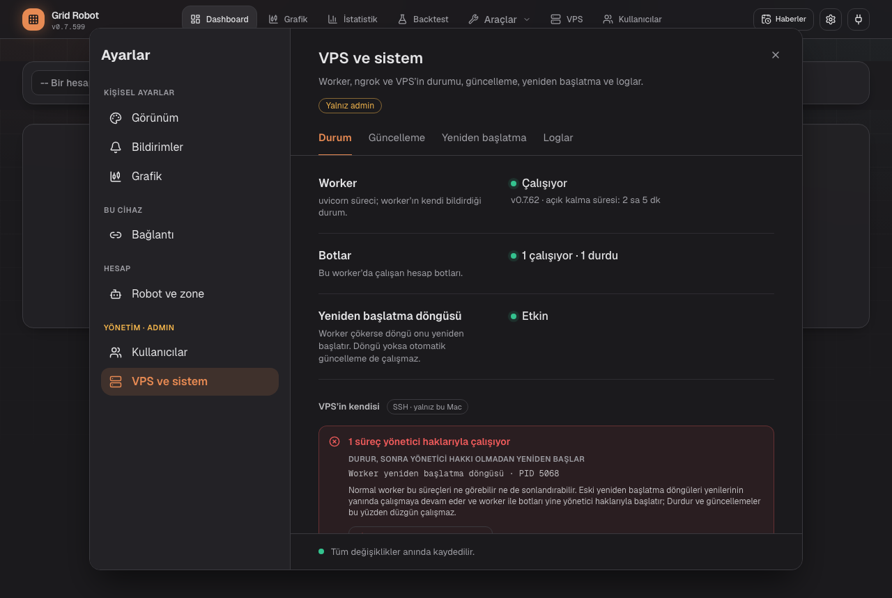
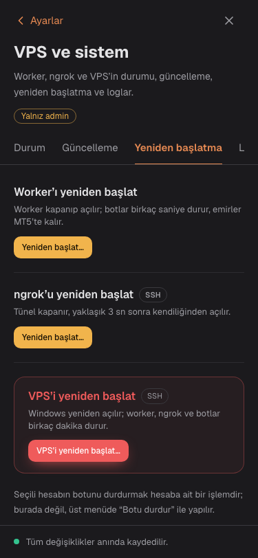
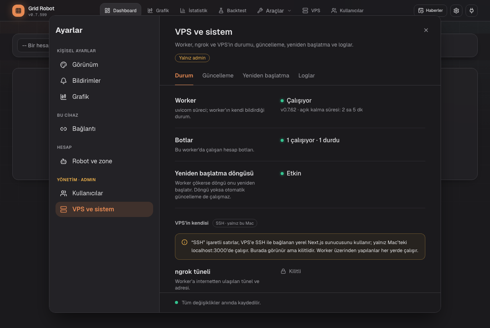

# Settings S5: "VPS and system" section, /vps redirects

## Request
Move all VPS and system work from the /vps page and the top menu into the settings dialog (plan 1115-A9.4, 1115-A9.6, design version 13).

## Problem
VPS work was split: the /vps page (SSH over the local Next.js server, plus a "Worker (online)" panel for Vercel) and the update entry in the top menu. The settings section "System" only showed the version.

## Solution
- Section `system` is now "VPS and system" (admin only) with four tabs: Status, Update, Restart, Logs (`SystemSection`, `components/settings/system/*`). The tab bar of S3 is shared with the notification tabs (`SECTION_TABS` in `SettingsDialog`).
- Worker data comes from the worker API and works everywhere (`useWorkerSystem`: status, bots, restart loop, update state, worker log, worker restart). The old "Worker (online)" panel is gone.
- SSH rows (ngrok, self-repair, automatic start, administrator processes, developer panel, ngrok restart, VPS restart, ngrok log) use `useVps` and the local `/api/vps` route. They carry the badge "SSH · this Mac only". When the route answers `localOnly` or is off, the rows stay visible but locked. A note at the top and the button hints give the reason. The security rules of the route did not change.
- Reused: `VpsElevatedWarning`, `AutoUpdateRow`, `useVps`, `UpdateModal`, `ConfirmModal` texts. Deleted: `VpsStatusPanel`, `VpsActions`, `VpsLogViewer`, `VpsOnlinePanel`. `uptime` and `selfHealState` moved to `components/vps/vpsFormat.ts`. `useVps({ withAutoUpdate: false })` skips the second `/system/worker/status` read, because the section reads it through the worker hook.
- Confirm windows of the restarts show the running bots, with LIVE or DEMO when the account list is known.
- "Shut down" (stop the bot of the selected account) is removed from the section (1115-A9.4). `useSystemActions` and `SystemModals` keep the flow for the top menu.
- `/vps` stays as a route. It opens the settings dialog in the section "VPS and system" and goes to `/`. Non-admins still see the admin lock.
- If the identity is unknown (worker off or not connected), the dialog opens the section "VPS and system" only when the page asked for it. This keeps the old way to restart a dead worker over SSH. The worker and the local route still enforce the real access.

## Why
One place for VPS and system work. The old route works for bookmarks.

## Known gaps
- The SSH update task ("Update and restart" through `AutoGrid-Update` when the worker is down) has no button any more. The route `/api/vps/update` still exists. The update window uses the worker (as in the design). Texts such as `update.checkFailed.hint` and the link in `UpdateModal` still point to the old VPS page.
- The logs "Update" (`vps_update.log`) and "Tunnel" (self-repair) are not in the section (the design has Worker and ngrok only).
- When the worker does not answer and SSH is open, the "Restart worker" button restarts it over SSH (the recovery path of the old page).
- Unused text keys of the old page (`vps.ctrl.*`, `vps.tile.*` labels, `vps.online.*`) stay in the i18n files.

## Verification
- `tsc --noEmit`, `eslint src`, `scripts/features/run.sh e2e VPS`: 22 tests green (new spec `settings-system.spec.ts`, tags VPS-01 to VPS-11, UPD-07).
- `scripts/features/precheck.sh` before the push: see PR.
- Screenshots (fake data only): 1280 px status (dark), 1280 px restart, 1280 px locked, 375 px restart, 375 px logs.

