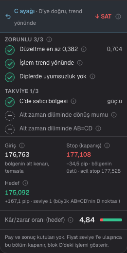
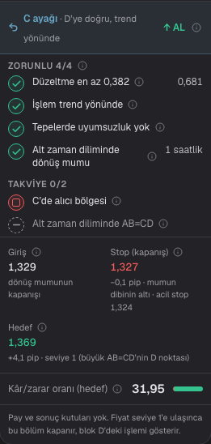
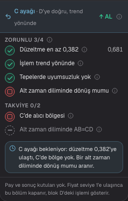

# AB=CD trade block: C leg section

## Request
Decision by Halil, 2026-11-16 (design approved, cards 9 and 10). Before D (level 1) is reached, the trade block of an AB=CD shows a "C leg" section: a trade from point C toward D, in the opposite direction of the AB=CD trade. For a sell AB=CD the C leg is a buy. It is a display, not an order. No share split, no result boxes, no status walk, no chart drawing.

## Solution
| File | Change |
|---|---|
| `lib/formation/cLeg.ts` (new) | `cLegOf` is a pure function (pattern of `reentry.ts`). It builds the list and the values. `noPeakDivergence` and `lowerCandleAt` measure two rows. |
| `lib/formation/reversal.ts` | New `reversalCandleAt` returns the reversal candle (timeframe, close, tip) next to the state. `reversalAt` calls it and returns only the state, so existing results do not change. |
| `lib/formation/types.ts`, `tradeApply.ts`, `abcdChecks.ts` | `Trade.cLeg?`. `abcdChecks.ts` calls `cLegOf` when D is not reached and there is no early reversal. `candidate.checks`, verdict, `invalidBy`, score, alarm and favorites do not change. |
| `components/formation/FormationTrade.tsx`, `i18n/messages/formation.ts`, `hints.ts` | New section with title, direction, the list ("Required n/m", "Reinforcement n/m"), the waiting line, entry, stop, target and the reward-to-risk ratio. tr, en and de, every field has a hint. Rows reuse `StateIcon` and the group names. |
| `e2e/mocked/formation-abcd-cleg.spec.ts` (new) | 28 library tests (sell and buy mirror), hand-calculated. |
| `e2e/mocked/formation-trade.spec.ts` | 7 block tests: card 9, card 10, waiting line, no higher timeframe, no section after D, 375 px light and dark. |

## Rules
The section shows when: the AB=CD candidate exists, D (level 1, with tolerance) is not reached, there is no early reversal, and no candle since C closed beyond the stop.

| Row | Kind | Meaning |
|---|---|---|
| Correction at least 0.382 | required | Depth of C, same measure as the existing depth check. The value is the depth. |
| Trade is with the trend | required | The trend of the next higher timeframe runs A to B. This is the opposite of the existing "with trend" measure of the AB=CD (which is relative to the AB=CD trade). Not measurable without a higher timeframe. |
| No divergence at the highs (lows for a sell leg) | required | No wave divergence between B and the previous turning point on the same side. |
| Buyer zone at C (seller zone) | reinforcement | Engulf zone or very strong fractal zone (see assumptions). |
| Reversal candle on a lower timeframe | required without a zone, reinforcement with a zone | Existing reversal measure, one timeframe lower, from candle C on. Value: the timeframe. |
| AB=CD on a lower timeframe | reinforcement | Not measured. The row is always grey. |

Values show only when all required rows are met:
- Zone at C: entry = near edge of the zone (the touch), stop = far edge (works on a candle close), target = level 1.
- No zone, reversal candle found: entry = close of the candle, stop = tip of the candle (a buy leg: its low), target = level 1.
- Neither: no values, only the waiting line.
The emergency stop is the stop plus or minus ATR(14), as in the other sections. The ratio uses `tradeMetrics`.

## Assumptions
- Zone at C: an Engulf zone of the C leg side that formed before candle C and that candle C touches (as in the re-entry section), or a fractal zone of the C leg side with the highest strength (2, as the strong-zone note of the target uses it), whose fractal candles are all before candle C and that candle C touches. Weak fractal zones do not count. With more than one zone the nearest far edge wins.
- A zone is consumed when a candle since the zone (Engulf zone) or since C (fractal zone) closed beyond its far edge. If every zone at C is consumed, the section is gone. For the candle variant the same rule uses the tip of the candle, from C on.
- Divergence: the two points compared are B and the last turning point of the same side before B (`divergenceOf`, `tie` as in the existing divergence check).
- Reversal candle: the first candle that the existing measure accepts, one timeframe lower. Its close is the entry. The tip is the extreme of the engulfing candles (without the engulfed candle).
- Delay: C is a confirmed turning point of the trend. A confirmed fractal needs candles after C, so the section appears after C is confirmed. The code is not changed (see measurements).

## Measurements (real fixtures)
All real fixtures hold one timeframe, H4 (100 fixtures; 9 of D1 and 1 of H1 are not AB=CD cases). Measured bar by bar in the 100 H4 fixtures, 4256 C points of the AB=CD search.
- Delay from candle C to the first moment that candle C is the C point of the candidate: 2 candles in 4173 of 4256 cases (98 %), 3 to 16 candles in the other 83. Two candles are the two right-side neighbors of the fractal.
- With H4 only, the section is born in 3018 of 4256 C points (all 100 fixtures), but never with values: the trend row and the candle row are not measurable without a higher and a lower timeframe. 3140 of 3617 sampled states have no zone; 477 have a zone.
- With a daily series built from the H4 candles (6 H4 candles per day), measured at every candle: 646 states in 82 fixtures show the zone variant. The candle variant needs a lower timeframe. No fixture has one, so it is only tested with synthetic hourly candles.
- Block tests use `bat-sell-h4-01` (zone variant, daily series derived from H4) and `abcd-breakc-h4-01` (candle variant and waiting line, hourly candles are synthetic).
- Existing results: the candidate (checks, verdict, `invalidBy`, points) and `trade` without `cLeg` are identical before and after the change in the 100 H4 fixtures, sampled at every third candle (20 MB of JSON, compared byte for byte).

## Open points
- [ ] The lower-timeframe AB=CD row is not measured yet. It is grey. Its measurement is a separate step.
- [ ] No chart drawing for the C leg.
- [ ] Not checked on a live chart. The mock series of the block tests use data derived from H4 and synthetic candles.
