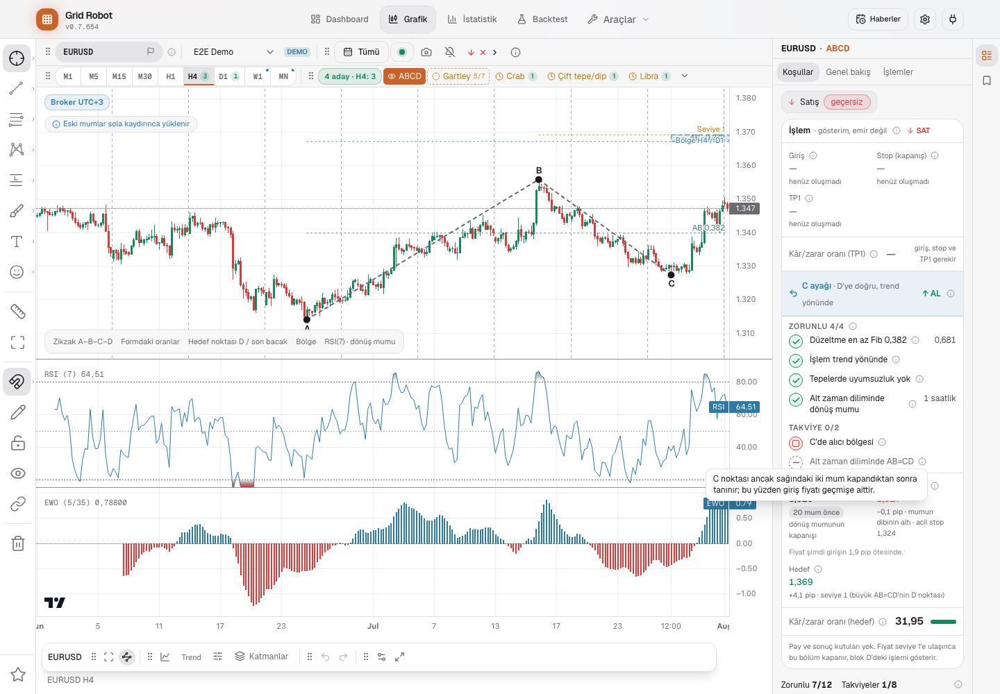
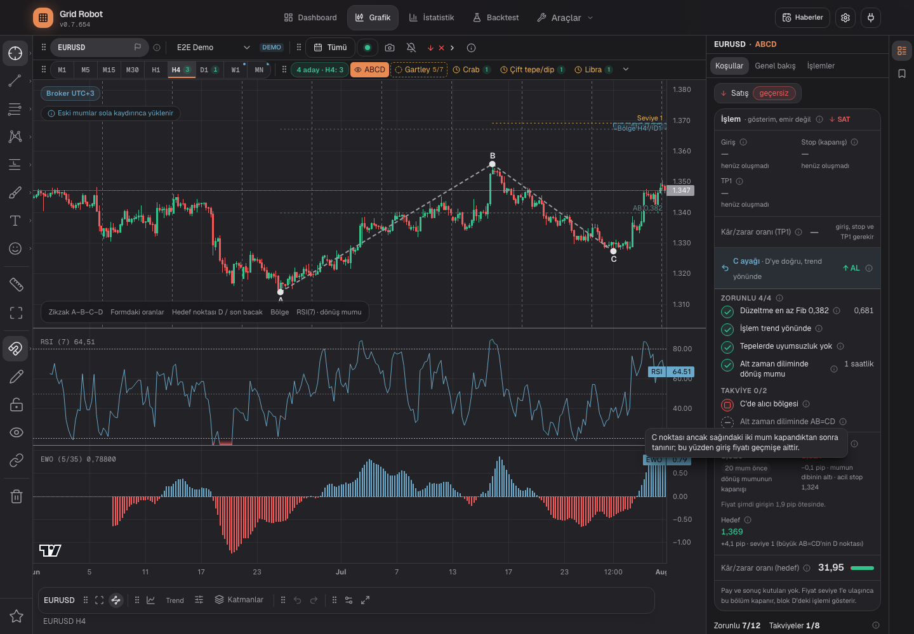

# C leg section: "N candles ago" note and Fib prefix

## Request
Decision by Halil, 2026-11-18 (design approved). The library knows point C only after the two candles to its right closed (98 % of cases exactly two candles, see `2026-11-16-abcd-c-leg.md`). So the entry price of the C leg section lies in the past. Timing and calculation stay. The section now says how many candles ago the entry was and how far the price is from it. Same day: Fibonacci levels in visible text carry the prefix "Fib".

## Solution
| File | Change |
|---|---|
| `lib/formation/cLeg.ts`, `reversal.ts`, `types.ts` | Pure output fields only, no calculation changed: `CLeg.entryIdx`, `barsSince` (candles from the entry candle to the last candle), `lastClose`. Zone variant: the entry candle is candle C (the touch). Candle variant: the candle of the view timeframe that contains the opening time of the lower-timeframe reversal candle (`ReversalCandle.time`, new, read from the existing bar). |
| `FormationTrade.tsx` | Badge "N candles ago" next to the entry value (in a `Tooltip`, wrapper `self-start`, so it does not stretch the column) and a faint line "Price is now X pip beyond / short of the entry." Beyond = price moved past the entry in the trade direction; short = the entry can still be reached. "Now" = close of the last candle of the view (also with `at=`). Not shown when N = 0, in the waiting state, or without values. |
| `i18n/messages/formation.ts`, `hints.ts` | Keys `formation.trade.cleg.past.{one,many,beyond,behind}` and `.past.hint` (tr/en/de). "Fib" before the levels in `cleg.row.depth`, `cleg.waiting`, `cleg.row.depth.hint`, `early.note`. |
| `e2e/mocked/formation-trade.spec.ts` | 7 tests: zone entry (N=2, "short of"), candle entry (N=20, "beyond"), N=1 singular, N=0, waiting state, tooltip on hover and keyboard focus, column alignment by bounding box. |

## Checks
- A first draft put the line between the entry and stop cells and pushed the stop cell into a second row. The alignment test now checks that the stop value stays on the entry row.
- Texts with "Fibonacci" or "Fibo" already in them were left unchanged (`tp2.hint`, `tp3.hint`, `early.hint`).

