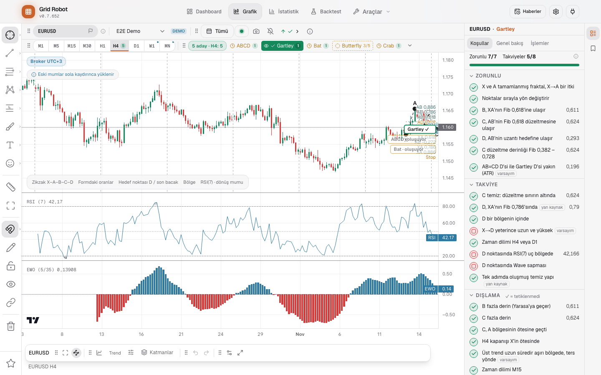
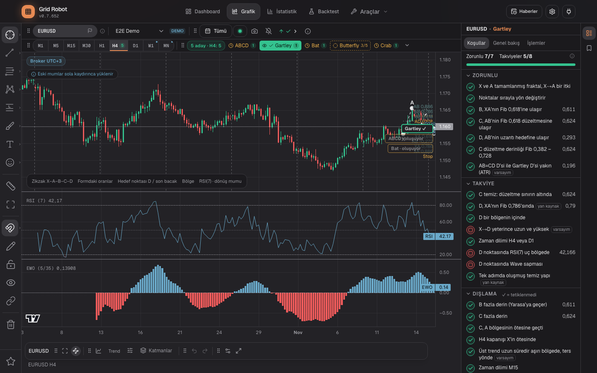

# Checklist marks are spelled out

## Request
The checklist rows ended in one- or two-letter marks (tr "V", "YK"; en "A", "SS"; de "A", "TK"). The rule "no opaque abbreviation in visible UI" applies. Halil approved the design on 2026-11-18: write the full word.

## Change
- `formation.mark.assumption`: tr "varsayım", en "assumption", de "Annahme". `formation.mark.secondary`: tr "yan kaynak", en "secondary source", de "Nebenquelle".
- Hints: the assumption hint no longer names a file; it says the source does not give the threshold, it was chosen, and it may change later. The secondary hint is reworded in Turkish only ("geçiyor"); en/de were already plain.
- The status badge now has `whitespace-nowrap` like the "inactive" badge: a long mark moves to the next line as one block and never breaks inside.
- The two keys are used only in `FormationChecklist.tsx` (dynamic key `formation.mark.${status}`). No other component shows them.

## Evidence
Mocked data, 1440 px, side panel 287 px. Rows with "varsayım" and "yan kaynak" wrap the mark below the text; values stay on the right edge.  

Test: `e2e/mocked/formation-page.spec.ts` (@FRM-19): every mark text has at least 4 characters; the assumption hint has no ".ts". The row-width test from PR 611 stays green.

## Open
Phone width (375 px) was not designed; UI-08 stays green.
