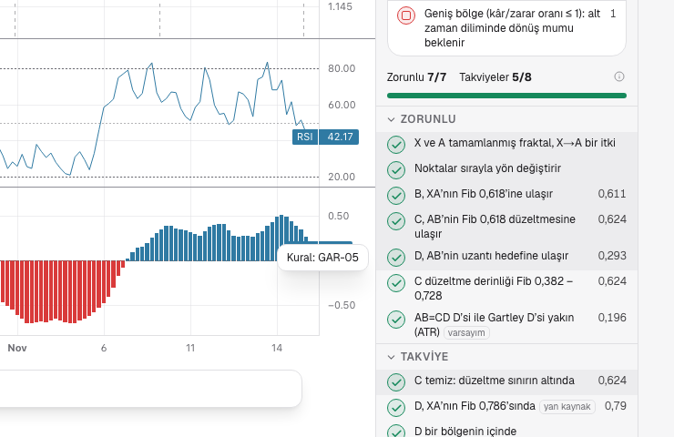
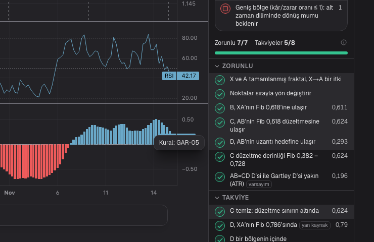
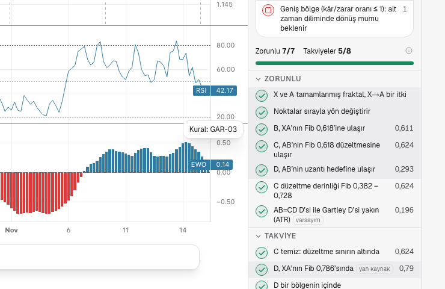
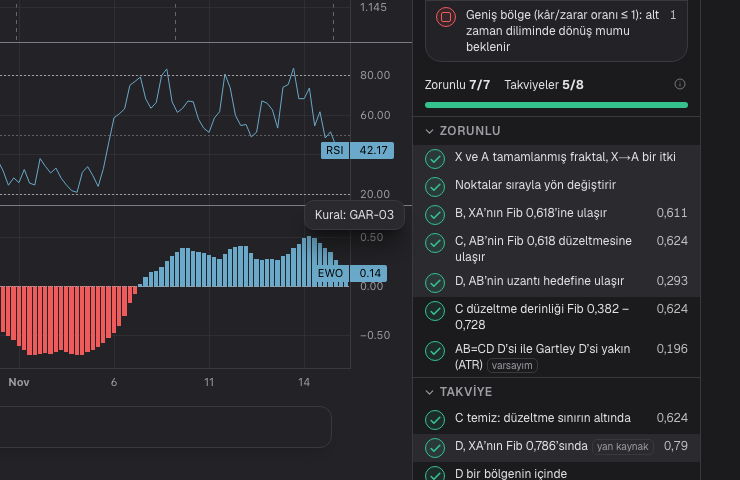

# Checklist row hint opens to the left

## Request
The hint "Kural: {id}" of a checklist row opened below the row and covered the text of the next row. Design approved by Halil on 2026-11-18: the hint opens to the left, outside the panel, over the chart. No row may be covered.

## Change
- `Tooltip` (`ui/tooltip.tsx`) has a new `side="left"`: the hint sits left of the anchor, centered vertically, clamped to the viewport. If there is no room on the left (narrow view), it falls back to the bottom position as before. `top` and `bottom` are unchanged.
- `FormationChecklist.tsx`: the row tooltip uses `side="left"`. The mark hints (veto, assumption, secondary source, not applicable) keep their direction. Row width and value alignment are unchanged.
- Test `e2e/mocked/formation-page.spec.ts` (@FRM-19), 1440 px, hover and keyboard focus: the hint box (a) touches no row box, (b) ends at or before the left edge of the row, (c) lies inside the viewport.

## Evidence
Screenshots (mocked data, 1440 px, crop shows the checklist rows, the hint and the price axis; light theme forced through `localStorage`, `html` class checked). Hover on the row "D, AB'nin uzantı hedefine ulaşır" (hint GAR-05), then on the row above it (hint GAR-03):    

Observation: the hint is readable in both themes (own background, border, shadow). It opens over the price-axis column of the chart, because the panel is next to it. Whether it covers an axis label depends on the row height. For GAR-05 it covers the "0.00" label and the "EWO 0.14" tag of the lower pane. For GAR-03 it sits between the "20.00" and "0.50" labels and covers none. So the hint can hide one axis label while it is open; it never covers a checklist row.

## Open
- Phone width (375 px) is not designed (Halil, 2026-11-17); there the hint falls back to the bottom.
