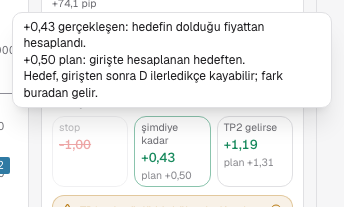
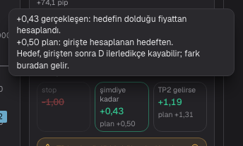

# Outcome box shows the plan value under the realized value

## Request
After TP1 hits, the outcome boxes ("so far", "if TP2 hits") show values from the real fill price. The plan value from the entry disappeared, so the user could not see why the two differ. Design approved by Halil on 2026-11-18.

## Change
Display only. `trade.ts` is unchanged.
- A box that shows a realized value (not the stop box) gets a small muted line "plan +0,50" under the large number. The line shows even when plan and realized are equal.
- The box is focusable and has a tooltip (hover and keyboard focus) with three lines: the realized value and how it was calculated, the plan value, and the note that the target can move after entry as D advances. For "if TP2 hits" and "if the large target hits" the first line is conditional.
- Open state, stop state and dimmed boxes are as before.
- The `Tooltip` wrapper is the grid item. Measured at 1440 px: all three boxes keep 76.3 px width in a 241 px grid, same as without the wrapper.

## Evidence
Screenshots (mocked data, 1440 px):  

Test: `e2e/mocked/formation-trade.spec.ts` (@FRM-39). The old expectation "TP1 box does not contain +0,50" changed: the plan line now contains it, so the test checks the full box text.

## Open
- The tooltip text for "if the large target hits" says "from the prices where targets filled and today's targets": `realizedOutcomesOf` uses fills for taken targets and the current `tp2` and `tpBig` for the rest.
