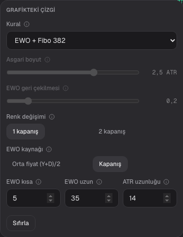

# Trend line set a high where the EWO pane was red: the line now uses the close for its EWO

## Request
Halil (1125-A1): on EURUSD H4 the trend line goes up from 2026-09-10 16:00 to a high at 2026-09-10 20:00. The EWO pane shows that candle red. A high must not be on a red EWO candle.

## Cause
The trend model and the EWO pane used two different EWOs.
- The trend model (rule `welle382`) calculated the EWO 5/35 from `(high + low) / 2` (`wave`, `indicators.ts`, SIG-10).
- The EWO pane of Halil's chart calculated it from the close, in percent.
- At 2026-09-10 20:00 the `(high + low) / 2` EWO was +0.0067 % (green). The close EWO was −0.0150 % (red). The pane showed −0.01499, which agrees with the close EWO to five digits.
- Thus the model accepted the high by its own EWO, and the pane showed the opposite color.
- The low at 16:00 was accepted by the two-candle color rule (2026-11-19): its EWO was green at the fractal candle and red at the completion candle (2026-09-11 00:00). The deeper wick at 12:00 (1.15918) was also a fractal. The model skipped it because the EWO stayed green from 12:00 to 20:00.

Data: EURUSD H4 from the DEMO account, read only. Pivots from `buildTrend` with `DEFAULT_TREND_SETTINGS`.

## Decision
Halil chose (1125-A1.3, 1125-A1.4) a new setting in the trend panel ("Grafikteki çizgi"): "EWO kaynağı" with "Orta fiyat (Y+D)/2" and "Kapanış". The default is "Kapanış", the source of the EWO pane in Halil's chart.  Halil chose the default after he saw the design of the field on an Artifact.

## Change
- `TrendOptions.ewoSource` (`'hl2' | 'close'`, `EWO_SOURCES`, `params.ts`). `TRD_PARAMS.trend.ewoSource` stays `hl2` (library base, SIG-10). `DEFAULT_TREND_SETTINGS.ewoSource` is `close`.
- `wave(bars, fast, slow, source)` (`indicators.ts`); the trend rules use `o.ewoSource` (`trdZug.ts`). The formation context EWO (`context.ts`) is not changed.
- `sanitizeTrendSettings`: a stored setting without a source, or with an unknown source, becomes `close`. `trendFingerprint` includes the source, so a change starts a new formation scan.
- Trend panel: segmented field "EWO kaynağı" below "Renk değişimi". It is disabled for the rule "Yalnız asgari boyut" (no EWO). i18n and hints in tr/en/de.
- A new EWO pane takes the source of the trend line, `DEFAULT_TREND_SETTINGS.ewoSource` (Halil, 1125-A1.5: "Evet, kapanış"). The other values stay from the rulebook (5/35, price difference). The menu entry "Kural kitabı ayarları" still sets `hl2` (SIG-10). Existing panes do not change.
- `FIXTURE_TREND` sets `ewoSource: 'hl2'`: the formation fixtures were verified with that source.

## Result

With the close EWO, the trend from the high 2026-09-09 12:00 goes to the low 2026-09-24 16:00 without the points 2026-09-10 16:00 and 20:00. With `(high + low) / 2` the two points stay.

## Tests
- `formation-trd-lib.spec.ts`, "TRD: EWO-Quelle" (@ANA-21): the EWO sign at 2026-09-10 20:00 for each source; the pivots for each source on EURUSD H4 (`e2e/fixtures/trd-ewo-source-eurusd-rows.ts`, 235 bars from 2026-08-01); the default and sanitize.
- `analysis-trend.spec.ts` (@ANA-21): the field, the default "Kapanış", the saved choice, disabled for "Yalnız asgari boyut".
- With the new default, 7 tests of real chart cases failed (formation search, targets, window start, trend checksum). Their cases were recorded with the old chart default. They now use `CHART_TREND_HL2` (`e2e/fixtures/formation-trend.ts`, the old default with `ewoSource: 'hl2'`). Their expected values did not change. The trend checksum (`formation-trend-digest.json`) is unchanged with `hl2`: this shows that the `hl2` path calculates as before.
- `analysis-trend-lib.spec.ts`: the expected default and the sanitized setting now contain `ewoSource: 'close'`.

## Open
- Stored user settings change to `close` at the next load. The formations of all products can change.
