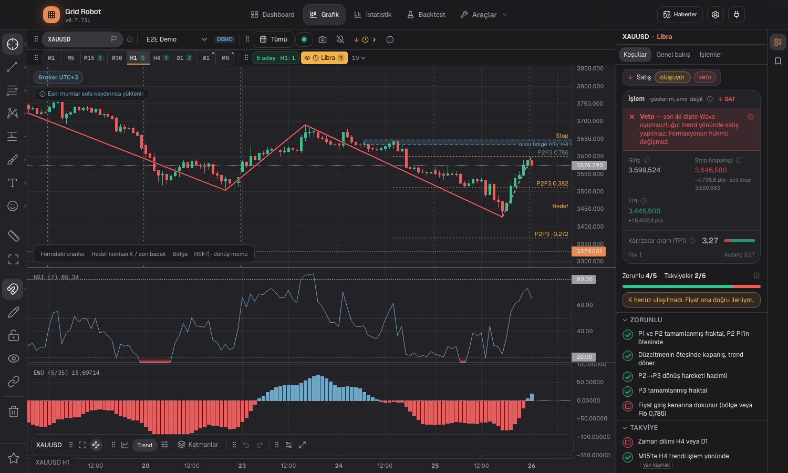
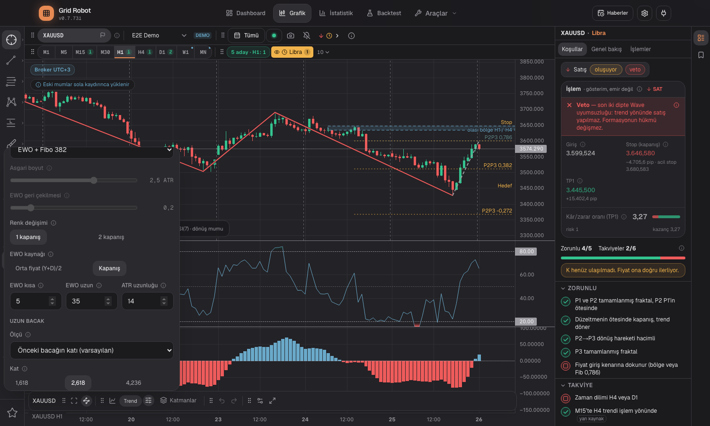

# The red trend line splits a leg that grew too long

## Request
Rule `welle382` (EWO + Fibo 382) extends a leg until a counter move reaches 38.2 % of it. When a leg grows very long, the line and the ABCD stay at old points. Example: on 24 Nov 2026 the app still showed the ABCD of 4 Sep on EURUSD H1.

## Decisions (Halil with the coordinator session, 25 and 26 Nov 2026)
- 1125-A2.3: the red line itself is split. The split also changes the trend direction.
- 1125-A2.1: the user chooses the measure for "too long" in the trend settings. The default is a multiple of the previous leg, 2.618.
- 1125-A2.4: the design of the setting group "Uzun bacak" is approved (Artifact).
- 1125-A2.2: the first top that the ABCD holds is A.
- 1126-A5: the inner points are only the ends of EWO waves (a second run with rule `welle`). The ABCD that Halil drew by hand came out exactly.
- 1126-A12: timing. The leg is split when C is complete (first C). ABCDs that split at a new low or high are not valid: they are born with ABCD-23.

## Change
- `trdSplit.ts` (`legSplitRule`) wraps the base rule of `TrendRun`, only for `welle382` and a measure other than off. The inner run has measure off, so it never splits.
- Trigger 1 (C comes): a counter fractal that the base rule rejects, in its side color on the EWO, with B the last point. A is S, or an EWO wave point of the S side between S and B. Depth of C is 0.382 to 0.728 of AB.
- Trigger 2 (fallback): the base rule extends the last point and the leg S to f is too long. A, B and C come from the EWO waves; depth 0.382 to 0.728, and the move C to f is at most 1.618 AB.
- Measures: multiple of the previous leg (1.618, 2.618, 4.236), ATR multiple (6 to 30, default 15, ATR at the end candle of the leg), number of candles (20 to 500, default 80), off.
- `TrendOptions`: `legMeasure`, `legMult`, `legAtr`, `legBars`. `DEFAULT_TREND_SETTINGS.legMeasure` is `mult`; `TRD_PARAMS.trend` stays `off` (library base). `trendFingerprint` holds the measure (only the field of the chosen measure), so a change asks "re-search the formations?". An old stored setting without the field becomes `mult`.
- Panel group "Uzun bacak" below "Grafikteki çizgi"; summary "long leg 2.618 ×" in the alarm menu and the confirm box. i18n and hints in tr/en/de.
- Fixtures: one year of H1 candles of XAUUSD and EURUSD (`e2e/fixtures/long-leg-*-h1.json`, 2025-11-03 to 2026-11-26, DEMO account, read only).

## Result
With the default setting, `buildTrend('H1', …)`:

| | Points | Trend changes | Splits |
|---|---|---|---|
| XAUUSD, split | 221 | 43 | 5 |
| EURUSD, split | 256 | 44 | 7 |
| XAUUSD, off | 203 | 43 | – |
| EURUSD, off | 181 | 33 | – |

XAUUSD at the end of November: 4148.52, 3832.42, 3886.69, 3502.81, 3689.66, 3426.69. This is the ABCD that Halil drew by hand. The tests (`@ANA-29`) check the five XAUUSD and seven EURUSD splits at the candle of the trigger.

## Not checked
The measures "ATR multiple" and "number of candles" have no reference. The tests only check that they calculate. The measure "multiple of the previous leg" is the one that was tested.

## Open (not built)
- 1126-A13.1: measure the reaction after a split against AB.
- 1126-A13.2: choice of the ABCD, big picture or newest triple.
- 1126-A5.1: H4 uses the H1 waves.

## Side observation
A triple whose depth does not hold (outside 0.382 to 0.728) can still carry a trade. The depth check applies to the split, not to a trade on a triple that exists already.
